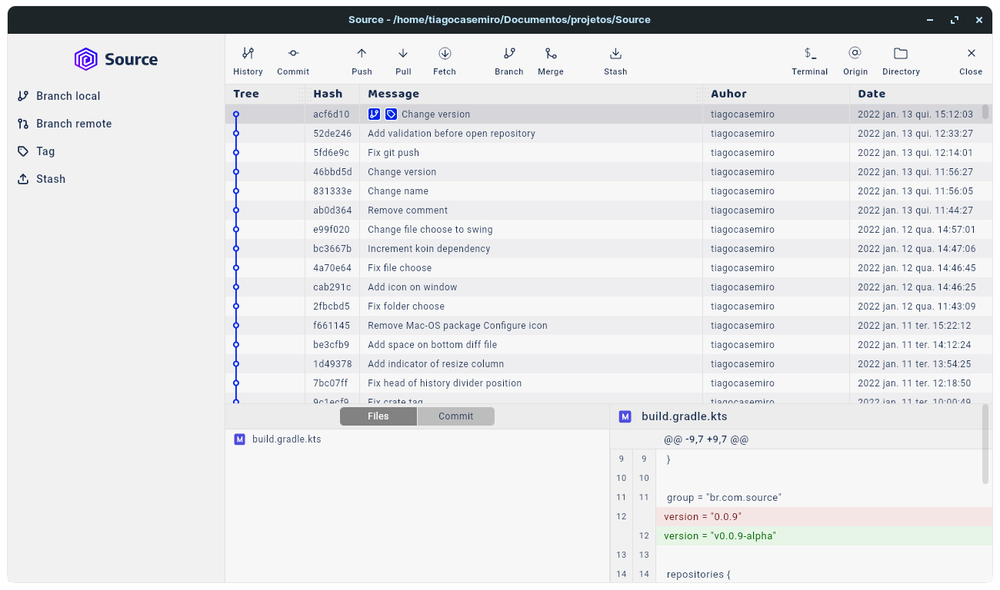
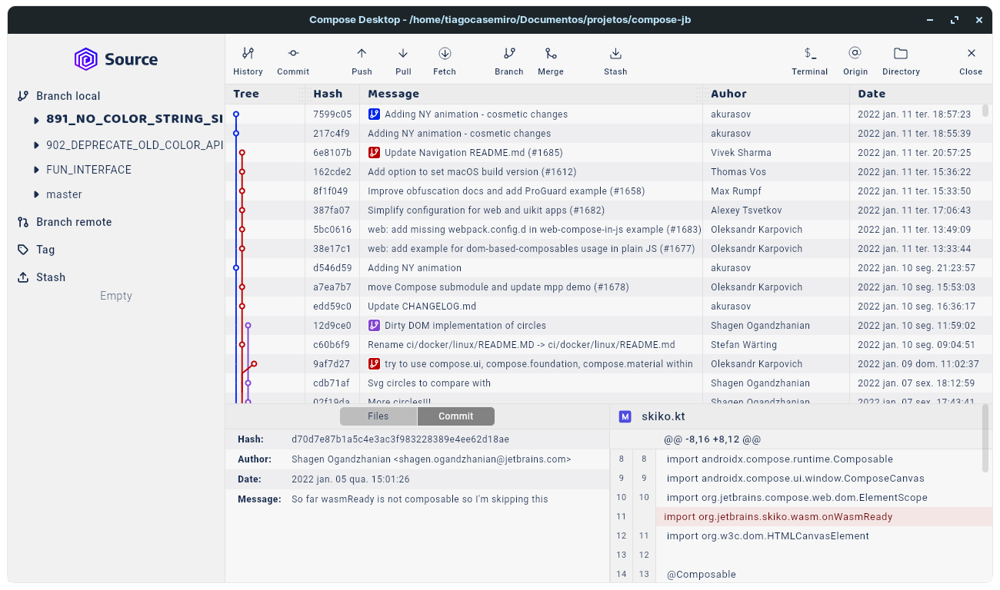
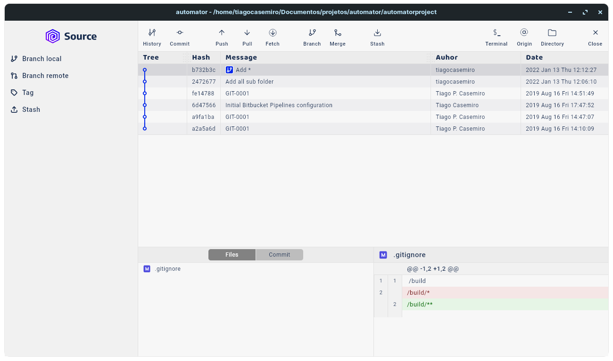
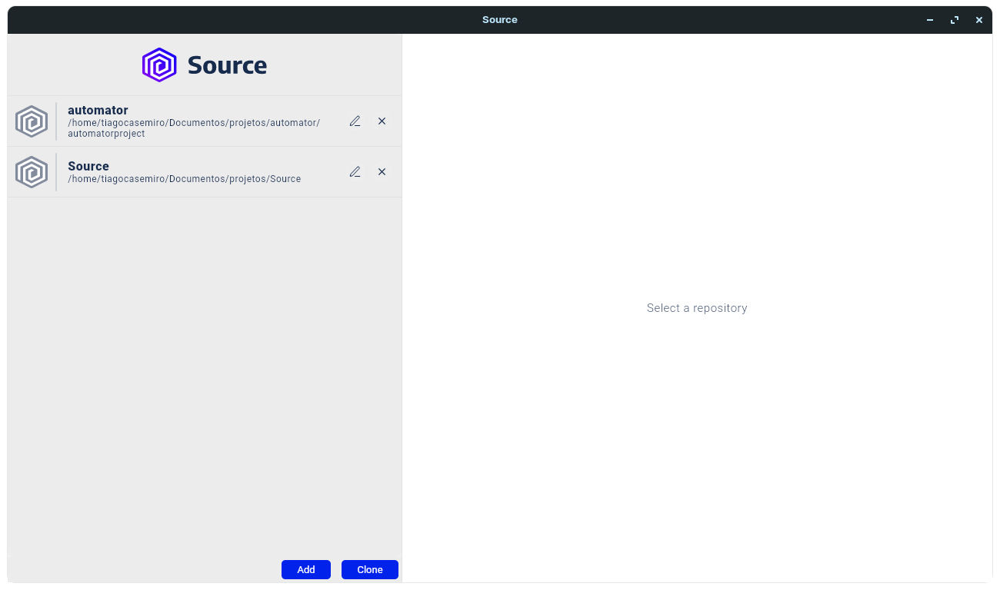
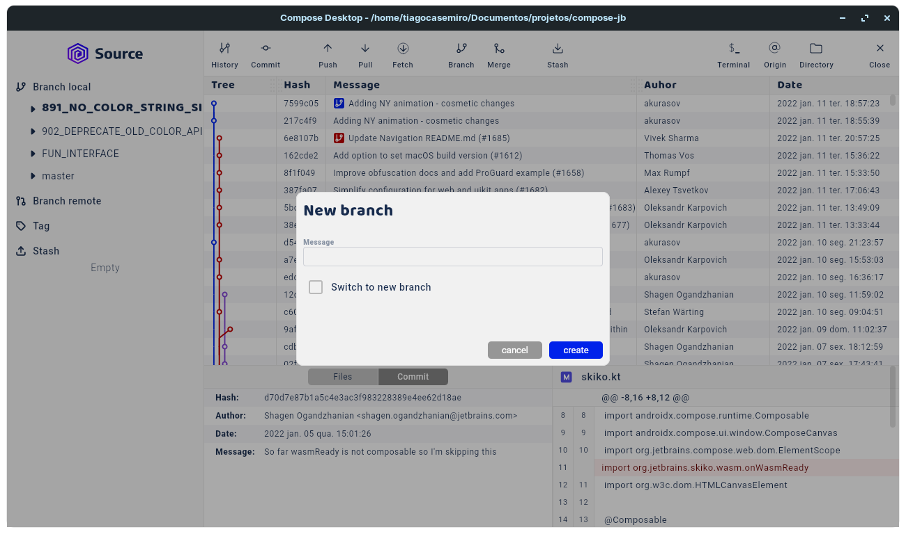
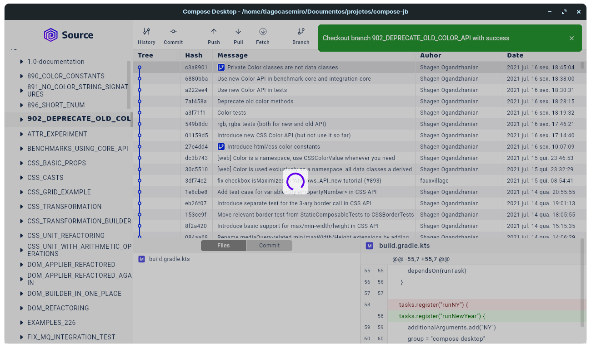
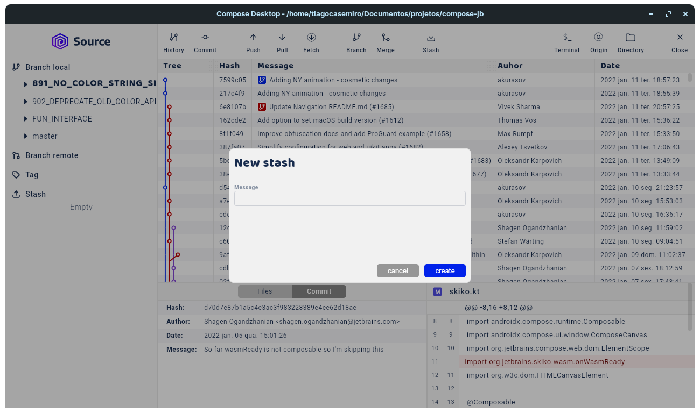

<p align="center">
  
</p>

<h1 align="center">Simplicity and power in a beautiful Git GUI</h1>

<p align="center">
  A free Git client for Linux — visualize and manage your repositories so you can focus on coding.
</p>

<p align="center">
  <a href="#getting-started"><strong>Get started</strong></a>
  ·
  <a href="#features">Features</a>
  ·
  <a href="LICENSE">License</a>
</p>

<p align="center">
  
</p>

---

## A free Git client for Linux

Source simplifies how you interact with your Git repositories so you can focus on coding. Visualize and manage your repositories through Source’s simple Git GUI — built with Compose Desktop and powered by JGit.

| | |
| --- | --- |
| **Simple for beginners** | Say goodbye to the command line — simplify distributed version control and quickly bring everyone up to speed. |
| **Powerful for experts** | Perfect for making advanced users even more productive. Review commits, stash, branch, merge, and more. |
| **Visualize your code** | Seeing really is believing. Get information on any branch or commit with a single click. |
| **Git on your desktop** | A fully-featured GUI that offers an efficient, consistent development process right out of the box. |

---

## Commit with confidence

Visualize your work and push with confidence. Inspect file diffs, review commit details, and ship changes knowing exactly what you’re sending.

<p align="center">
  
</p>

---

## A fully-featured client

### The new Git status

Never miss a thing. Stay on top of your work and up to date with your code at a glance.

<p align="center">
  
</p>

### Visualize your progress

Detailed branching diagrams make it easy to keep up with your team’s progress — hashes, messages, authors, and dates in one place.

### Manage all your repositories

Add local projects or clone remotes from a clean repository list. Switch between projects without leaving the app.

<p align="center">
  
</p>

### Branch and switch with ease

Create branches, switch context, and get clear feedback when a checkout succeeds.

<p align="center">
  
  &nbsp;
  
</p>

---

## Git at your fingertips

Not just a Git GUI. Source places the power of Git front and center in an easy-to-use interface.

| Feature | Description |
| --- | --- |
| **Push, pull & fetch** | Keep local and remote in sync with one click from the toolbar. |
| **Branch & merge** | Create branches, switch between them, and merge without leaving the UI. |
| **Stash** | Park work in progress and come back to it later — create and apply stashes visually. |
| **Commit history** | Explore the graph, open any commit, and inspect file-level diffs. |
| **Clone & open** | Clone a remote repository or open an existing local one. |
| **Delete branch** | Clean up finished work from the same place you manage branches. |
| **Terminal & directory** | Jump to a shell or open the project folder when you need the command line. |

<p align="center">
  
</p>

---

## Getting started

### Requirements

- Linux (x64 or arm64)
- JDK 15+
- Git available on your system

### Run from source

```bash
./gradlew run
```

### Package

Source can be packaged as **Deb**, **Rpm**, or **AppImage**:

```bash
./gradlew packageDeb
./gradlew packageRpm
./gradlew packageAppImage
```

---

## Built with

- [Kotlin](https://kotlinlang.org/) & [Compose Desktop](https://www.jetbrains.com/lp/compose-multiplatform/)
- [JGit](https://www.eclipse.org/jgit/)
- [Koin](https://insert-koin.io/)
- [Nitrite](https://github.com/nitrite/nitrite-java)

---

<p align="center">
  <strong>Source</strong> — the Linux GUI Git client<br />
  <a href="LICENSE">EPL-2.0</a>
</p>
